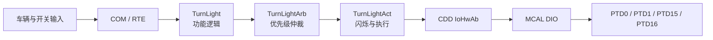

# S32K14x AUTOSAR 转向灯项目

这是一个基于 AUTOSAR Classic 的转向灯学习与集成工程，包含 Simulink/Stateflow 应用模型、生成的应用代码、RTE 与 BSW/MCAL 配置、ARXML 系统描述、硬件抽象代码及 IAR 工程描述。

仓库重点展示转向灯功能从应用层到硬件层的完整调用链，同时把各层代码分开说明。编译所需的 Vector MICROSAR、MCAL 和芯片支持包属于外部依赖，未随仓库分发。

## 功能链路

## 目录与分层

| 层级 | 目录 | 主要内容 |
| --- | --- | --- |
| 应用模型 | `ApplicationModel/` | TurnLight、TurnLightArb、TurnLightAct 的 Simulink/Stateflow 模型、数据脚本和 SWC ARXML |
| 应用软件层（ASW） | `Project/Appl/Source/TurnLight*` | 转向灯主逻辑、控制命令仲裁、闪烁执行及模型生成代码 |
| ECU 抽象/硬件抽象 | `Project/Appl/Source/Cdd_IoHwAb.c` | 将四路灯控命令映射到 DIO 通道 |
| 集成与调度 | `Project/Appl/Source/OsAppTask.c`、`Project/Appl/GenData/Rte*` | Runnable、RTE 接口、OS 事件与任务集成 |
| BSW 配置层 | `Project/Appl/GenData/`、`Project/Config/ECUC/` | COM、CanIf、CanSM、PduR、EcuM、BswM、OS 等模块的生成配置 |
| MCAL 配置层 | `Project/Appl/GenData/src/`、`Project/Appl/GenData/include/` | Dio、Mcu、Port、Spi 的生成配置 |
| 系统与接口描述 | `Project/Config/` | SWC、端口、数据类型、通信矩阵映射及系统提取 ARXML |
| 通信输入 | `Project/Inputfiles/` | CAN DBC、INI 和诊断描述输入 |
| 工程描述 | `Project/` 根目录 | IAR 工程、工作区和配置工具入口 |
| 学习与验证记录 | `docs/` | 配置流程、联调步骤、验证记录与迁移说明 |

## 三个应用组件

- `TurnLight`：采集车辆状态和灯光请求，形成转向灯控制请求。
- `TurnLightArb`：依据请求优先级、位置、开关状态、周期、次数和占空比进行输出仲裁。
- `TurnLightAct`：以 10 ms Runnable 驱动四路灯状态，输出 CAN 状态并调用 IoHwAb 服务控制实际 DIO。

IoHwAb 当前通道映射如下：

| 灯位 | DIO 通道 |
| --- | --- |
| 前左 FL | PTD0 |
| 前右 FR | PTD1 |
| 后左 RL | PTD15 |
| 后右 RR | PTD16 |

## 外部依赖

完整编译需要与原工程版本匹配的 IAR Embedded Workbench、AUTOSAR 配置工具、Vector MICROSAR BSW、S32K1xx MCAL/芯片支持包以及相应授权。具体模块清单见 [`Project/vendor-dependencies.md`](Project/vendor-dependencies.md)。

打开 `Project/IarStartApp.eww` 或导入 `Project/ASR_S32K144_Start.ewp` 后，需要恢复工程原有的 BSW、MCAL 和 Device 路径。当前工程描述同时出现 S32K144 工程命名与 S32K148 启动/链接文件，下载前应确认目标板芯片型号和链接脚本一致。

